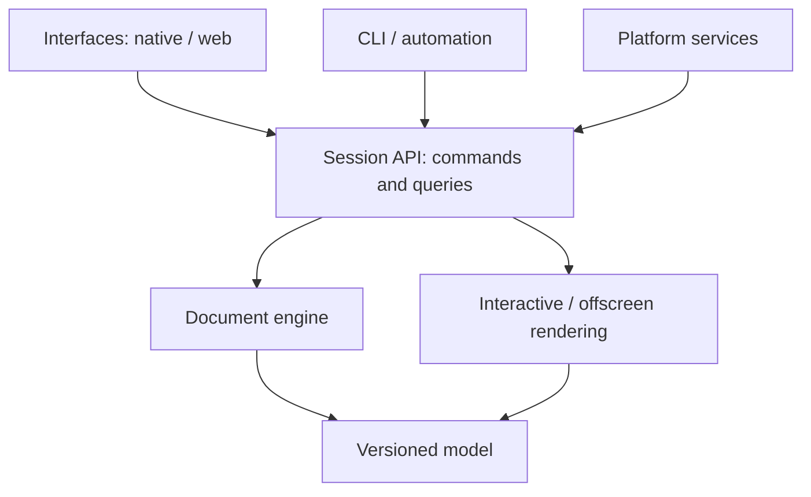

# Universal plan — 2D creative composition editor

> **Document type:** product specification, logical architecture, and roadmap, deliberately **independent of any technology**.
>
> **Audience:** a developer, coding agent, or team responsible for building the project.
>
> **Absolute rule:** this document describes **what the product must do**, **how its responsibilities are separated**, and **how to verify its behavior**. It does not prescribe a language, framework, graphics engine, library, or build system.
>
> **Role in this repository:** this is the technology-neutral reference specification. Later direct user instructions and project contracts govern implementation-specific choices.

## 1. Vision

Create a **local-first, lightweight, extremely responsive, enjoyable** 2D composition editor: a creative workspace for freely assembling images, text, groups, masks, and effects without the accumulated complexity of large graphics applications.

The intended experience is a modern artistic tool: a clean interface, consistent components, responsive canvas, intuitive shortcuts, direct manipulation, immediately visible changes, and no perceptible slowdowns during ordinary use.

The user is an artist who works on Linux among other platforms and wants to enjoy composing images without depending on a heavyweight graphics suite.

### Pillars

1. **Creation first:** reach the visual result quickly.
2. **Real performance:** responsiveness, controlled memory use, and no unnecessary idle work.
3. **Durable architecture:** add features without rewriting unrelated parts.
4. **The same engine everywhere:** native interface, browser, automation, and headless execution follow the same rules.
5. **Local-first:** users control their projects and assets; no mandatory account or server.
6. **Non-destructive:** effects and masks remain editable, removable, and reorderable.

### Initially out of scope

- Reproducing every capability of Affinity, Photoshop, or Figma.
- 3D editing, online collaboration, mandatory cloud services, a marketplace, and social features.
- A complete video timeline, arbitrary-code plugins, or AI segmentation in the first prototype.
- Making domain rules depend on interface components.

## 2. Expected outcome of the first real prototype

A person must be able to:

1. Open the application and find a **local project gallery**.
2. Create a composition with explicit dimensions, background, and units.
3. Paste an image or text; drop **multiple images at once**.
4. Position, move, transform, and reorder elements without obvious stuttering.
5. Create **nested layers and groups**; hide/show and lock any element.
6. Add a **mask** to a layer or group.
7. Apply a configurable **dither effect** to a layer or group without affecting others.
8. Add and edit text, including font selection and essential properties.
9. Add guides/margins and use magnetic alignment.
10. Use shortcuts, undo/redo, save, and reopen a composition.
11. Export an image that matches the canvas.

The same document must be creatable, editable, savable, and exportable **without a graphical interface**.

## 3. Logical architecture: boundaries that must never be broken

Separate five fundamental responsibilities:

| Domain | Responsibility | Must not know about |
| --- | --- | --- |
| **Document model** | Describe data, identities, layers, properties, and relationships | Windows, widgets, input devices, rendering |
| **Document engine** | Apply commands, validate rules, manage history | Button and menu placement |
| **Rendering engine** | Turn a scene into pixels and produce exports | The UI framework choice |
| **Services and adapters** | Files, clipboard, fonts, storage, platform | Layer-composition domain rules |
| **Client interfaces** | Display state and forward user intentions | Direct mutation of internal state |

### Responsibility graph



**Principle:** arrows represent explicit contracts, not permission to share internal structures freely.

### Required invariants

- The engine can operate without a window or graphics environment.
- Document manipulation does not require an active renderer.
- The rendering engine produces the same logical result for the canvas, thumbnails, and export.
- A keyboard shortcut, button, and automated operation invoke **the same command**.
- The interface never changes a document directly: it submits an intention and receives new state.
- Modules are decoupled by explicit, replaceable contracts; no giant utility module absorbs everything.
- Every documented feature has a verification path that does not require a mouse.

## 4. Organizing responsibilities into directories

This is a **conceptual** tree to adapt to the chosen language, not a mandatory list of package or file names.

```text
project/
├── apps/
│   ├── native/                   # Desktop startup and integration
│   ├── browser/                  # Browser startup and integration
│   └── headless/                 # CLI and windowless automation
├── core/
│   ├── document/                 # Metadata, version, identity
│   ├── layers/                   # Layer types and hierarchy
│   ├── groups/                   # Isolation, children, order
│   ├── masks/                    # Masks and alpha operations
│   ├── geometry/                 # Transforms, bounds, coordinate systems
│   ├── text/                     # Content and typography styles
│   ├── guides/                   # Guides, margins, snapping
│   ├── effects/                  # Effect instances and parameters
│   └── animation/                # Track and keyframe data
├── engine/
│   ├── session/                  # Active document and queries
│   ├── commands/                 # Public operations API
│   ├── validation/               # Invariants and permissions
│   ├── transactions/             # Grouping gestures into operations
│   ├── history/                  # Undo/redo and checkpoints
│   ├── selection/                # Targets and multiple selection
│   └── events/                   # Observable changes
├── rendering/
│   ├── scene/                    # Composition evaluation
│   ├── compositing/              # Blending and transparency
│   ├── graph/                    # Dependencies between passes
│   ├── clipping/                 # Bounds, groups, and masks
│   ├── effects/                  # Effect catalog execution
│   ├── cache/                    # Reuse and invalidation
│   ├── thumbnails/               # Layer previews
│   └── export/                   # Offscreen rendering
├── effect-library/
│   ├── registry/                 # Catalog and versions
│   ├── parameters/               # Generic control definitions
│   ├── dither/                   # First effect
│   └── future-effects/           # Future independent effects
├── services/
│   ├── assets/                   # Images, fonts, metadata
│   ├── projects/                 # Opening, saving, migrations
│   ├── clipboard/                # Pasted text and images
│   ├── import/                   # Import and bulk drops
│   ├── storage/                  # Abstract local storage
│   ├── jobs/                     # Asynchronous work and cancellation
│   └── platform/                 # Adapters and capabilities
├── interface/
│   ├── design-system/            # Tokens, themes, components
│   ├── navigation/               # Gallery and topbar
│   ├── canvas/                   # View and user gestures
│   ├── layers-panel/             # Interactive tree
│   ├── properties-panel/         # Contextual inspector
│   ├── toolbar/                  # Tools
│   ├── shortcuts/                # Configurable shortcuts
│   ├── popovers/                 # Floating menus and controls
│   └── timeline/                 # Future animation interface
├── tests/
│   ├── unit/
│   ├── integration/
│   ├── scenarios-headless/
│   ├── golden-rendering/
│   └── fixtures/
└── docs/
    ├── architecture/
    ├── behaviors/
    ├── performance/
    └── testing/
```

**Extension rule:** each major domain owns its directory and submodules. Avoid dozens of unrelated feature files at the same level. The core never depends on `interface/`.

## 5. Document model

A **project** contains one or more documents (one is sufficient for the MVP), a thumbnail gallery, metadata, and local assets. A **document** contains:

- A stable identifier and format version.
- Dimensions, background, color profile/settings, and units.
- An ordered tree of nodes: layers, groups, masks, and potentially specialized objects.
- References to original assets without unnecessary duplication.
- Guides, margins, and display settings.
- Metadata compatible with future animation tracks.

### MVP node types

| Type | Minimum data |
| --- | --- |
| Image | Asset reference, intrinsic size, transformation |
| Text | Content, font family/fonts, size, weight, spacing, alignment, color, transformation |
| Group | Ordered children, transformation, compositing mode |
| Mask | Source and target, combination mode, enabled state |

All nodes expose shared properties: identifier, name, parent, order, visible, locked, opacity, transformation, optional masks, ordered effects, and metadata.

### Graph invariants

- No parenting or mask cycles.
- A node has at most one direct parent; identifiers are not reused within an open document.
- Editing a group respects its children and their relative transformations.
- Locking a parent prevents modifications to its descendants according to an explicit rule.
- Hiding a parent hides its descendants without changing their individual visibility flags.
- Invalid operations fail with an explicit error and leave no partially modified document.

## 6. Commands, state, and history

The engine exposes an **intention-oriented API**:

- `CreateDocument`, `InsertImage`, `InsertText`.
- `SelectNodes`, `MoveNodes`, `TransformNodes`, `ReorderNodes`.
- `CreateGroup`, `Ungroup`, `RenameNode`, `SetVisibility`, `SetLocked`.
- `AttachMask`, `RemoveMask`, `UpdateMask`.
- `AddEffect`, `MoveEffect`, `UpdateEffect`, `RemoveEffect`.
- `AddGuide`, `UpdateMargins`, `DeleteGuide`.
- `SaveProject`, `ExportDocument`.

These names represent **abstract intentions**, not prescribed syntax or programming interfaces.

Each command has a type, stable target, validated parameters, clear result, and observable changes.

### Transactions

- A drag containing hundreds of small pointer movements produces **one Undo entry** when the gesture finishes.
- A multi-layer operation is atomic: either everything succeeds or nothing changes.
- Undo/redo restores parent/child relationships, masks, and effect order as well.
- Transient drag previews may display before the final commit without polluting history.
- Selection belongs to a clearly defined session layer rather than persistent data unless explicitly chosen otherwise.

## 7. Layers, groups, and masks: visual rules

### Composition order

For each layer:

1. Read and prepare its source image or text.
2. Apply the specified transformations.
3. Apply its effects **in the chosen order**.
4. Apply masks and opacity in a documented contractual order.
5. Composite the result into its parent using the specified blend mode.

For a group:

1. Evaluate children in stacking order.
2. Build an intermediate group result when its mode is **isolated**.
3. Apply the group's effects and masks to the **combined result**.
4. Composite that result into its parent group.

A *pass-through* group mode is a possible extension; it requires explicit semantics and dedicated tests.

### Clipping: a non-negotiable rule

**An effect attached to one layer never changes another layer's pixels.** A group effect affects only that group's result.

Distinguish two concepts:

- **Influence:** the effect does not affect another branch of the tree.
- **Geometric bounds:** some future effects, such as shadows, glow, or blur, may visually extend a layer. Their overflow must be controlled by an explicitly labeled confinement mode available at the effect or group level.

For the MVP, dither **preserves original alpha and masks**: transparent pixels never become visible and the effect never leaks outside its target layer/group.

## 8. Effect system: an extensible library

An effect is not a specialized hardcoded panel. It is a module containing:

- Stable identifier and version.
- Name, category, and description.
- Typed parameters, bounds, defaults, and units.
- Application rules: source, opacity, confinement, and compatibility.
- A visual evaluation function and resource preparation function when necessary.
- Declared dependencies and rules for what must be recalculated when parameters change.

The inspector builds its controls from this description. Adding an effect should generally require only **registering its definition and execution**, without modifying every view.

### First effect: Dither

Use **perceptually pleasing dither**, with blue-noise distribution or an algorithm of comparable quality, reproducible for identical parameters.

Possible initial parameters:

- Dither amount.
- Number of levels per channel.
- Pattern scale.
- Stable generation seed.
- Monochrome or color mode.
- Blend with the original image.

### Essential test cases

1. Dither on one image: other images remain unchanged.
2. Dither on a group: all children participate; nothing outside the group changes.
3. Transparent mask: no dither appears outside the permitted alpha.
4. Moving a layer: no unwanted pattern artifacts or random flickering.
5. Same document and settings: identical results after save and reopen.

### Later effects, outside the MVP

Color correction, curves, hue/saturation, contrast, levels, halftone, ASCII, displacement, glow, blur, glass, chromatic aberration, posterization, grain, outlines, and procedural textures.

## 9. Rendering engine: pipeline and invalidation

The rendering engine receives **coherent scene state** and produces a result; it does not decide which user commands are valid.

### Responsibilities

- Build a scene representation and composition order.
- Evaluate layer, mask, group, and effect dependencies.
- Calculate the necessary portions based on viewport, zoom, and changes.
- Reuse intermediate results that remain valid.
- Prepare thumbnails and exports through consistent rendering paths.
- Control available memory and release resources that are no longer needed.

### Dependency graph

A change must invalidate only what it affects:

| Action | Minimum expected recalculation |
| --- | --- |
| Rename a layer | UI tree, not its pixels |
| Move a layer | Its transformation and affected parent compositions |
| Change dither | That effect pass and its dependent outputs |
| Hide a group | Ancestor composition; retain reusable caches |
| Change text color | The affected text, its effects, and parent composites |
| Move a guide | Canvas overlay, not the exported image |

### Rendering priorities

1. **Gesture responsiveness:** prioritize visible, directly manipulated content.
2. **Final quality:** complete details after or between interactions.
3. **Secondary jobs:** thumbnails, preloading, and caching when resources permit.

For a very heavy composition, a cheaper temporary preview is acceptable **only if limited to the gesture** and the final result remains faithful.

### Idle state and resource consumption

- Render **on demand**: an unchanged image must not be recomposed continuously.
- Produce the necessary updates while the user interacts or an animation is active.
- Suspend unnecessary redraws as soon as interaction and pending jobs finish.
- Background work must not sustain an unnecessary display loop.
- Aim for near-zero idle CPU without promising **absolute 0%**, which depends on the platform.

### Workloads to measure

A composition with **at least 15 images**, groups, several masks and effects; rapid zoom/pan; multiple selection; simultaneous import; bursts of undo/redo; high-resolution export; and opening a large project.

Measure operation duration, input latency, frame stability, memory use, and import peaks. **No performance number may be presented as established without measurement.**

## 10. Interface and design system

Visual direction: a **premium, restrained, slightly rounded, readable creative application**, with blue accent `#2C6BF9`, combining Figma's precision with Affinity's artistic approach.

### Structure

| Area | Content |
| --- | --- |
| Topbar | File, save, undo/redo, title, settings |
| Left — tools | Selection, hand, text, guides, manipulation tools |
| Left — layers | Hierarchical tree, thumbnails, locking, visibility, groups |
| Center | Canvas, zoom, pan, rulers, grid, selections, handles |
| Right — properties | Transformations, dimensions, opacity, text, masks, effects |
| Popovers | Short settings, contextual menus, pickers, sub-options |

### Reusable components

Buttons, fields, sliders, color pickers, units, switches, icons, active/inactive states, menus, reorderable lists, trees, tooltips, resizable panels, confirmation dialogs, and notifications.

Components share color, spacing, border, radius, and animation-duration tokens; avoid inconsistent local styles.

### Animation and blur

- Short animations for popovers, menus, hover, selections, and panel transitions.
- Responsive gestures without motion that compromises precision.
- A light blur behind some popovers **when supported**, with a clean, contrasting fallback otherwise.
- No continuous decorative animation that prevents returning to idle.
- Respect reduced-motion preferences.

## 11. Fundamental interactions

### Canvas

- Cursor-anchored zoom, intuitive pan, stable coordinates.
- Single/multiple selection, selection rectangle, transformation handles.
- Display dimensions, bounds, alignments, guides, and margins.
- Optional grid, configurable snapping, and temporary shortcut-based snapping bypass.
- Selection events synchronize the canvas, layer tree, and inspector.

### Layer tree

- Drag and drop to reorder or move into a group.
- Precise destination preview before dropping.
- Clear rejection of forbidden moves: cycles, locked parents, or invalid destinations.
- Near-real-time thumbnails **without blocking the interface**.
- Eye/lock controls must not accidentally change the current selection.

### Clipboard and import

One logical service describes `PasteText`, `PasteImage`, `PasteMultipleAssets`, `DropAssets`, and `ImportFiles`.

- Pasting text creates an editable text element.
- Pasting an image creates a layer at the intended position.
- Dropping multiple images creates multiple layers within one Undo transaction.
- If the source supplies multiple formats, define a documented priority and offer a choice when useful.
- Protect the user from silent partial imports; identify rejected files.
- Platform security restrictions and permissions belong in adapters, not the engine.

## 12. Text and typography

Text is not a permanently flattened bitmap. A text element retains content, styles, fonts, size, weight, italic state, line height, letter spacing, alignment, color, text-box dimensions, and transformation.

- Direct editing on the canvas and in the inspector.
- Explicit, predictable substitution when a font is missing.
- Future support for multiple styles inside one text block.
- Thumbnails and export follow the same text-layout rules.
- Measurement, reflow, and bounds are independent of editing widgets.

## 13. Guides, margins, and alignment

A shared guide system must support:

- Adding, deleting, and moving horizontal and vertical guides.
- Setting safety margins in one action.
- Resetting and temporarily hiding guides.
- Snapping to layer edges, centers, and points of interest.
- Clearly displaying the chosen alignment value.

Guides are **editing elements**, excluded from final export by default.

## 14. Local-first projects, gallery, and saving

### Gallery

At startup, show recent local projects with thumbnail, name, modification date, dimensions, and `Create`, `Open`, `Duplicate`, `Rename`, and `Delete` actions; deletion requires confirmation.

### Logical format

A project contains at least:

- A versioned manifest.
- Complete document and node state.
- Asset references and identities/content according to the chosen portability mode.
- Regenerable thumbnails and useful metadata.

### Reliability

- Atomic or recoverable saving as far as the platform permits.
- Autosave with status feedback and recovery after an abrupt shutdown.
- Tested schema migrations: opening an old document must not destroy it.
- Never destructively reencode an original image on every save.
- No network upload is required to create, edit, save, or export a project.

## 15. Future keyframe animation

Plan a **document animation engine separate from the interface** now. The MVP does not require a complete timeline UI.

Future schema:

- `Timeline`: duration, reference frame rate, markers.
- `Track`: stable target and animatable property path.
- `Keyframe`: time, value, interpolation, optional tangents.
- `Evaluator`: document state at the requested time without destructively changing base values.

Potential animation targets include transformations, opacity, effect parameters, masks, and relevant text values.

**Two separate engines:** small popover animations remain interface animations; keyframes transform document evaluation and must work headlessly.

## 16. Planned extensions without immediate implementation

- New effect libraries: color, shader, spatial processing.
- New layer types and blend modes.
- Object/person segmentation, potentially local and optional, represented by an operation producing an editable mask.
- Temporal animation and sequential exports.
- Scripts, batch processing, automation, and headless processing.
- Additional import/export formats and improved interoperability.

An extension must **add a capability through a known contract**, without requiring panels, history, or the document core to be rewritten.

## 17. Session API and headless execution

Every client uses one shared logical service:

- **Create / Load / Save:** document lifecycle.
- **Execute:** validated command, potentially transactional.
- **Query:** immutable snapshots, properties, or part of the tree.
- **Subscribe:** relevant changes without rereading everything.
- **Render / Export:** scene output, including without a window.
- **Capabilities:** context-dependent support for import, storage, rendering, and permissions.

Headless execution can edit and serialize documents **even without a graphics accelerator**. Visual rendering requires an available rendering backend; when none exists, return a clear error rather than simulating success.

## 18. Verification strategy

### What the agent must test automatically

- Project creation, serialization, saving, and reloading.
- Tree invariants: nested groups, impossible cycles, child order.
- Locking, visibility, selection, and atomic multi-operations.
- Correct mask/effect confinement and deterministic composition order.
- Undo/redo, including dragging, grouping, and effect insertion/removal.
- Guide snapping and transformations with known values.
- Identical reference-scene exports when a rendering backend is available.
- Format evolution and representative older documents.
- Commands operating without an interface.

### What the user will test personally

- Native windows: fluidity, visual behavior, drag/drop, clipboard, keyboard, real rendering.
- Browser: interactions, permissions, import/paste, export, and rendering on their machine.
- Perceived performance under load, stability, memory use, and animation consistency.

**The agent must not present a successful build as a successful interactive test.** After each stage, report the headless tests actually executed and provide the user with a manual verification checklist. A UI feature receives final acceptance only after that feedback.

## 19. Roadmap through verifiable increments

Every stage must produce a usable outcome rather than an accumulation of empty files.

### Phase 0 — Contracts and skeleton

- Define responsibilities, the conceptual tree, shared interfaces, and forbidden dependencies.
- Define the minimum document schema and command contracts.
- Implement automated boundary validation.

**Verification:** the headless application creates an empty document, saves it, and reloads it.

### Phase 1 — Usable core

- Images, simple text, transformations, layers, groups, visibility, and locking.
- Atomic commands, snapshots, events, and undo/redo.

**Verification:** headless tree, property, and transaction tests; no frontend required.

### Phase 2 — First composition rendering

- Offscreen rendering, transparency, layer order, transformations, and isolated groups.
- Initial export and reference images.

**Verification:** a multi-layer composition exports the expected image and preserves unaffected pixels.

### Phase 3 — Masks and the first effect

- Masks, confinement, effect library, and configurable dither.
- Thumbnails use the same visual pipeline.

**Verification:** confinement tests and golden tests for layers and groups.

### Phase 4 — Minimum creative interface

- Gallery, canvas, topbar, toolbar, layer panel, and inspector.
- Selection, movement, zoom/pan, reordering, and property controls.

**Verification:** the agent tests the core; the user tests native/browser interactions.

### Phase 5 — Productivity and polish

- Text/image clipboard, bulk drops, guides/margins/snapping, shortcuts.
- Reusable components, blue `#2C6BF9`, asynchronous thumbnails, restrained transitions, popover blur when supported.
- Robust persistence, loading state, understandable errors.

**Verification:** a complete creative workflow from import to export.

### Phase 6 — Performance and reliability

- Profiling, precise invalidation, bounded caches, memory cleanup, large documents.
- Tests with 15+ images, groups, masks, and effects.
- Idle behavior and long-session verification.

**Verification:** a reproducible measurement table, documented known issues, and user-confirmed interaction quality.

### Later

Timeline/keyframes, advanced effects, optional segmentation, extended interoperability, and automation.

## 20. Definition of Done

A feature can be declared ready for delivery only when:

1. It meets a specific user need and a described scenario.
2. It respects boundaries between document, engine, rendering, platforms, and interface.
3. Its errors and edge cases have clear behavior.
4. Document changes remain undoable and serializable where necessary.
5. It does not unnecessarily recompute unaffected data.
6. Its headless tests have run, or their limits are clearly stated.
7. A manual visual-verification checklist is available.
8. It introduces no unnecessary dependencies between separate domains.

---

## First assignment for the agent

**Start with a small, complete vertical slice:** document → two layers → group → transactional command → offscreen rendering → export → save/reload → headless tests. Only then connect the first visual interface.

**Do not choose a stack from this document:** technology is selected separately. Preserve this domain architecture and these behaviors as the reference even if implementation changes completely.
