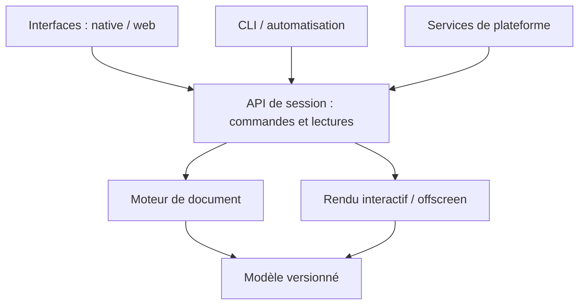

# Plan universel — Éditeur de composition créative 2D

> **Nature du document :** spécification produit, architecture logique et feuille de route, volontairement **indépendantes de toute technologie**.
>
> **À qui il s'adresse :** un développeur, un agent de programmation ou une équipe chargée de construire le projet.
>
> **Règle absolue :** ce document décrit **ce que le produit doit faire**, **comment ses responsabilités sont séparées** et **comment vérifier son fonctionnement**. Il n'impose aucun langage, framework, moteur graphique, bibliothèque ni système de build.

## 1. Vision

Créer un éditeur de composition 2D **local-first, léger, extrêmement fluide et agréable à utiliser** : un espace de création où l'on assemble librement des images, du texte, des groupes, des masques et des effets, sans la complexité accumulée des grands logiciels de création.

L'expérience recherchée est celle d'un outil artistique moderne : interface propre, composants cohérents, canvas réactif, raccourcis intuitifs, manipulations directes, changements immédiatement visibles et absence de ralentissements perceptibles dans les usages courants.

L'utilisateur est un artiste qui travaille notamment sous Linux et veut retrouver le plaisir de composer des images sans dépendre d'une suite graphique lourde.

### Piliers

1. **Création d'abord :** atteindre le résultat visuel rapidement.
2. **Performances réelles :** réactivité, mémoire maîtrisée et aucun travail inutile au repos.
3. **Architecture durable :** fonctionnalités ajoutables sans réécrire les autres parties.
4. **Même moteur partout :** interface native, navigateur, automatisation et exécution sans interface utilisent les mêmes règles.
5. **Local-first :** projets et ressources sous le contrôle de l'utilisateur ; aucun compte ni serveur obligatoire.
6. **Non destructif :** conserver la capacité de modifier, retirer et réordonner les effets et les masques.

### Hors périmètre initial

- Reproduire toutes les capacités d'Affinity, de Photoshop ou de Figma.
- Édition 3D, collaboration en ligne, cloud obligatoire, marketplace et fonctions sociales.
- Timeline vidéo complète, système de plugins exécutant du code arbitraire ou segmentation par IA dans le premier prototype.
- Faire dépendre les règles métier des composants de l'interface.

## 2. Résultat attendu au premier vrai prototype

Une personne doit pouvoir :

1. Ouvrir l'application et retrouver une **galerie locale de projets**.
2. Créer une composition avec dimensions, fond et unités explicites.
3. Coller une image ou du texte ; déposer **plusieurs images à la fois**.
4. Positionner, déplacer, transformer et réordonner les éléments sans saccades évidentes.
5. Créer des **calques et groupes imbriqués** ; masquer/afficher et verrouiller n'importe quel élément.
6. Ajouter un **masque** à un calque ou à un groupe.
7. Appliquer un **effet de dither** paramétrable à un calque ou un groupe, sans déborder sur les autres.
8. Ajouter et modifier du texte, avec sélection de police et propriétés essentielles.
9. Ajouter des guides/marges et bénéficier de l'alignement magnétique.
10. Utiliser des raccourcis, annuler/rétablir, sauvegarder et rouvrir la composition.
11. Exporter une image fidèle au canvas.

Ce même document doit pouvoir être créé, modifié, enregistré et exporté **sans interface graphique**.

## 3. Architecture logique : les frontières à ne jamais casser

Séparer cinq responsabilités fondamentales :

| Domaine | Responsabilité | Ce qu'il ne doit pas connaître |
| --- | --- | --- |
| **Modèle de document** | Décrire les données, identités, calques, propriétés et relations | Fenêtres, widgets, périphériques, rendu |
| **Moteur de document** | Appliquer les commandes, valider les règles, gérer l'historique | Placement des boutons ou menus |
| **Moteur de rendu** | Transformer une scène en pixels et effectuer les exports | Choix du framework UI |
| **Services et adaptateurs** | Fichiers, clipboard, polices, stockage, plateforme | Règles de composition des calques |
| **Interfaces clientes** | Afficher l'état et transmettre les intentions de l'utilisateur | Mutations directes de l'état interne |

### Graphe de responsabilité



**Principe :** les flèches indiquent l'utilisation de contrats explicites, pas la permission de partager librement des structures internes.

### Invariants incontournables

- Le moteur peut fonctionner sans fenêtre et sans environnement graphique.
- La manipulation des documents ne nécessite pas de dispositif de rendu actif.
- Le moteur de rendu produit le même résultat logique pour le canvas, les miniatures et l'export.
- Un raccourci clavier, un bouton et une opération automatisée déclenchent **la même commande**.
- L'interface ne modifie jamais directement le document : elle soumet une intention et reçoit un nouvel état.
- Les modules sont découplés par des contrats explicites et remplaçables ; aucun module « utilitaire géant » n'absorbe tout.
- Toute fonctionnalité documentée a un moyen de validation qui ne dépend pas d'une souris.

## 4. Organisation des responsabilités en dossiers

Arborescence **conceptuelle** à adapter au langage choisi ; il ne s'agit pas de noms de packages ou de fichiers imposés.

```text
project/
├── apps/
│   ├── native/                   # Démarrage et intégration bureau
│   ├── browser/                  # Démarrage et intégration navigateur
│   └── headless/                 # CLI et automatisation sans fenêtre
├── core/
│   ├── document/                 # Métadonnées, version, identité
│   ├── layers/                   # Types de calques et hiérarchie
│   ├── groups/                   # Isolation, enfants, ordre
│   ├── masks/                    # Masques et opérations alpha
│   ├── geometry/                 # Transformations, bounds, repères
│   ├── text/                     # Contenus et styles typographiques
│   ├── guides/                   # Guides, marges et snapping
│   ├── effects/                  # Instances d'effets et paramètres
│   └── animation/                # Données de tracks et keyframes
├── engine/
│   ├── session/                  # Document actif et requêtes
│   ├── commands/                 # API publique des opérations
│   ├── validation/               # Invariants et permissions
│   ├── transactions/             # Regroupement des gestes
│   ├── history/                  # Undo/Redo et checkpoints
│   ├── selection/                # Cibles, sélection multiple
│   └── events/                   # Changements observables
├── rendering/
│   ├── scene/                    # Évaluation de la composition
│   ├── compositing/              # Mélange et transparence
│   ├── graph/                    # Dépendances entre passes
│   ├── clipping/                 # Bornes, groupes et masques
│   ├── effects/                  # Exécution du catalogue d'effets
│   ├── cache/                    # Réutilisation et invalidation
│   ├── thumbnails/               # Prévisualisations de calques
│   └── export/                   # Rendu hors écran
├── effect-library/
│   ├── registry/                 # Catalogue et versions
│   ├── parameters/               # Définitions génériques de contrôles
│   ├── dither/                   # Premier effet
│   └── future-effects/           # Effets indépendants à venir
├── services/
│   ├── assets/                   # Images, typographies, métadonnées
│   ├── projects/                 # Ouverture, sauvegarde, migrations
│   ├── clipboard/                # Texte et images collés
│   ├── import/                   # Import et dépôt multiple
│   ├── storage/                  # Stockage local abstrait
│   ├── jobs/                     # Travail asynchrone et annulation
│   └── platform/                 # Adaptateurs et capacités
├── interface/
│   ├── design-system/            # Tokens, thèmes et composants
│   ├── navigation/               # Galerie et topbar
│   ├── canvas/                   # Vue et gestes utilisateur
│   ├── layers-panel/             # Arbre interactif
│   ├── properties-panel/         # Inspecteur contextuel
│   ├── toolbar/                  # Outils
│   ├── shortcuts/                # Raccourcis configurables
│   ├── popovers/                 # Menus et contrôles flottants
│   └── timeline/                 # Interface future d'animation
├── tests/
│   ├── unit/
│   ├── integration/
│   ├── scenarios-headless/
│   ├── golden-rendering/
│   └── fixtures/
└── docs/
    ├── architecture/
    ├── behaviors/
    ├── performance/
    └── testing/
```

**Règle d'extension :** chaque grand domaine possède son dossier et ses sous-modules. Éviter les dizaines de fichiers de fonctionnalités sans rapport au même niveau. Le noyau ne dépend jamais de `interface/`.

## 5. Modèle du document

Un **projet** contient un ou plusieurs documents (un seul suffit au MVP), une galerie de miniatures, des métadonnées et des ressources locales. Un **document** contient :

- Un identifiant stable et une version de format.
- Dimensions, fond, profil/paramètres de couleur et unités.
- Un arbre ordonné de nœuds : calques, groupes, masques et éventuellement objets spécialisés.
- Des liens vers les ressources d'origine, sans duplication inutile.
- Des guides, marges et réglages d'affichage.
- Des métadonnées compatibles avec de futurs tracks d'animation.

### Types de nœuds du MVP

| Type | Données minimales |
| --- | --- |
| Image | Référence d'asset, taille intrinsèque, transformation |
| Texte | Contenu, familles/polices, taille, graisse, espacement, alignement, couleur, transformation |
| Groupe | Liste ordonnée d'enfants, transformation, mode de composition |
| Masque | Source et cible, mode de combinaison, activation |

Tous les nœuds exposent des propriétés communes : identifiant, nom, parent, ordre, visible, verrouillé, opacité, transformation, masques éventuels, liste ordonnée d'effets et métadonnées.

### Invariants du graphe

- Aucun cycle de parenté ou de masque.
- Un nœud a au maximum un parent direct ; les identifiants ne sont pas réutilisés dans un document ouvert.
- Modifier un groupe respecte ses enfants et leurs transformations relatives.
- Verrouiller un parent empêche les opérations de modification de ses descendants, selon une règle explicite.
- Masquer un parent masque ses descendants sans modifier leurs propres flags de visibilité.
- Les opérations invalides sont rejetées avec une erreur explicite, sans document à moitié modifié.

## 6. Commandes, état et historique

Le moteur présente une **API orientée intentions** :

- `CreateDocument`, `InsertImage`, `InsertText`.
- `SelectNodes`, `MoveNodes`, `TransformNodes`, `ReorderNodes`.
- `CreateGroup`, `Ungroup`, `RenameNode`, `SetVisibility`, `SetLocked`.
- `AttachMask`, `RemoveMask`, `UpdateMask`.
- `AddEffect`, `MoveEffect`, `UpdateEffect`, `RemoveEffect`.
- `AddGuide`, `UpdateMargins`, `DeleteGuide`.
- `SaveProject`, `ExportDocument`.

Ces noms sont des **intentions abstraites**, pas une syntaxe ni une interface de programmation imposée.

Chaque commande possède : un type, une cible stable, des paramètres validés, un résultat clair et un ensemble de changements observables.

### Transactions

- Un déplacement de souris composé de centaines de petits mouvements donne **une seule entrée Undo** lorsque le geste se termine.
- Une opération sur plusieurs calques est atomique : tout réussit ou rien ne change.
- Undo/Redo rétablit aussi les relations parent/enfant, les masques et l'ordre des effets.
- Les aperçus transitoires pendant le drag peuvent être affichés avant le commit final, sans polluer l'historique.
- L'état de sélection appartient à une couche de session clairement définie, et non aux données persistantes sauf choix explicite.

## 7. Calques, groupes et masques : règles visuelles

### Ordre de composition

Pour chaque calque :

1. Lire et préparer sa source (image ou texte).
2. Appliquer les transformations définies.
3. Appliquer ses effets **dans l'ordre choisi**.
4. Appliquer ses masques et son opacité selon un ordre contractuel documenté.
5. Composer le résultat dans son parent, en respectant le mode de mélange.

Pour un groupe :

1. Évaluer les enfants dans leur ordre de superposition.
2. Construire le résultat intermédiaire du groupe lorsque son mode est **isolé**.
3. Appliquer les effets et masques du groupe au **résultat combiné**.
4. Composer ce résultat dans son groupe parent.

Le mode de groupe « traversant » ou *pass-through* est une évolution possible ; il doit avoir une sémantique explicite et des tests dédiés.

### Clipping : règle non négociable

**Un effet attaché à un calque ne modifie jamais les pixels d'un autre calque.** Un effet attaché à un groupe n'agit que sur le résultat de ce groupe.

Attention à distinguer deux notions :

- **Zone d'influence :** l'effet n'affecte aucune autre branche de l'arbre.
- **Limite géométrique :** certains effets futurs (ombre, glow, blur) peuvent étendre visuellement la zone du calque. Leur dépassement doit être contrôlé par un mode de confinement clairement indiqué, activable au niveau de l'effet ou du groupe.

Pour le MVP, le dither **préserve l'alpha et le masque d'origine** : aucun pixel transparent ne devient visible et l'effet ne fuit pas hors du calque/groupe ciblé.

## 8. Système d'effets : banque extensible

Un effet n'est pas un panneau spécialisé codé en dur. Il se présente comme un module avec :

- Identifiant et version stables.
- Nom, catégorie et description.
- Liste typée de paramètres, bornes, valeurs par défaut et unités.
- Règles d'application : source, opacité, confinement, compatibilité.
- Fonction d'évaluation visuelle et, si nécessaire, fonction de préparation des ressources.
- Déclaration de ses dépendances et de ce qui doit être recalculé quand un paramètre change.

L'inspecteur construit ses contrôles à partir de cette description. Ajouter un effet doit généralement se limiter à **enregistrer sa définition et son exécution**, sans modifier toutes les vues.

### Premier effet : Dither

Utiliser un **dither perceptuellement agréable**, avec distribution de bruit bleu (*blue noise*) ou algorithme de qualité comparable, reproductible pour des paramètres identiques.

Paramètres initiaux possibles :

- Intensité du dither.
- Nombre de niveaux par canal.
- Échelle du motif.
- Graine de génération stable.
- Mode monochrome ou couleur.
- Mélange avec l'image d'origine.

### Cas de test essentiels

1. Dither sur une image seule : les autres images ne changent pas.
2. Dither sur un groupe : tous les enfants participent au calcul, rien hors du groupe ne change.
3. Masque transparent : aucune trace de dither hors de l'alpha autorisé.
4. Déplacement du calque : aucun motif parasite non souhaité ni scintillement aléatoire.
5. Même document, mêmes réglages : même résultat après sauvegarde puis réouverture.

### Effets suivants (pas au MVP)

Corrections de couleur, courbes, teinte/saturation, contraste, niveaux, halftone, ASCII, displacement, glow, blur, verre, aberration chromatique, posterization, grain, contours, texture procédurale.

## 9. Moteur de rendu : pipeline et invalidation

Le moteur de rendu reçoit **un état de scène cohérent** et produit un résultat ; il ne décide pas quelles commandes utilisateur sont valides.

### Responsabilités

- Construire une représentation de la scène et de l'ordre de composition.
- Évaluer les dépendances de calques, masques, groupes et effets.
- Calculer les portions nécessaires en fonction du viewport, du zoom et des modifications.
- Réutiliser les résultats intermédiaires encore valides.
- Préparer miniatures et exports via des chemins de rendu cohérents.
- Contrôler la mémoire disponible et libérer les ressources devenues inutiles.

### Graphe de dépendances

Une modification ne doit invalider que ce qu'elle affecte :

| Action | Recalcul minimal attendu |
| --- | --- |
| Renommer un calque | Arbre UI, pas ses pixels |
| Déplacer un calque | Sa transformation et les compositions parentes concernées |
| Changer le dither | Ce pass d'effet et ses sorties dépendantes |
| Masquer un groupe | Composition des ancêtres ; conserver les caches réutilisables |
| Modifier une couleur du texte | Texte concerné, effets associés et composites parents |
| Déplacer un guide | Overlay du canvas, pas l'image exportée |

### Priorités de rendu

1. **Réactivité du geste :** afficher en priorité ce qui est visible et manipulé.
2. **Qualité définitive :** compléter les détails après ou entre les interactions.
3. **Travaux secondaires :** miniatures, préchargement et cache quand les ressources le permettent.

Si une composition est très lourde, un aperçu temporairement moins coûteux est acceptable **s'il est clairement borné au geste** et que le résultat final reste fidèle.

### Repos et consommation

- Rendu **à la demande** : une image immobile ne doit pas être recomposée en boucle.
- Tant que l'utilisateur interagit ou qu'une animation est active, produire les mises à jour nécessaires.
- Dès que l'interaction et les tâches sont terminées, suspendre les redraws non indispensables.
- Un travail d'arrière-plan ne doit pas maintenir une boucle d'affichage inutile.
- Viser un CPU proche de zéro au repos, sans promettre artificiellement un **0 % absolu**, qui dépend de la plateforme.

### Cas de charge à mesurer

Une composition avec **au moins 15 images**, des groupes, plusieurs masques et effets ; zoom/pan rapides ; sélection multiple ; import simultané ; undo/redo en rafale ; export haute résolution ; ouverture d'un gros projet.

Mesurer les durées des opérations, les latences d'entrée, la stabilité des frames, la consommation mémoire et les pics lors des imports. **Aucun chiffre de performance ne doit être présenté comme acquis sans mesure.**

## 10. Interface et design system

Direction visuelle : **application créative premium, sobre, légèrement arrondie, lisible**, avec un accent bleu `#2C6BF9`, proche de la précision de Figma et de l'approche artistique d'Affinity.

### Structure

| Zone | Contenu |
| --- | --- |
| Topbar | Fichier, sauvegarde, annuler/rétablir, titre, réglages |
| Gauche — outils | Sélection, main, texte, guides et outils de manipulation |
| Gauche — calques | Arbre hiérarchique, miniatures, verrouillage, visibilité, groupes |
| Centre | Canvas, zoom, pan, repères, grille, sélections et handles |
| Droite — propriétés | Transformations, dimensions, opacité, texte, masques, effets |
| Popovers | Réglages courts, menus contextuels, sélecteurs et sous-options |

### Composants réutilisables

Boutons, champs, sliders, sélecteurs de couleur, unités, interrupteurs, icônes, états actif/inactif, menus, listes réordonnables, arbres, tooltips, panneaux redimensionnables, fenêtres de confirmation et notifications.

Les composants utilisent les mêmes tokens de couleurs, espacements, bordures, rayons et durées d'animation ; éviter les styles locaux incohérents.

### Animations et blur

- Animations courtes pour popovers, menus, survols, sélections et transitions de panneaux.
- Sensation de vélocité lors des gestes, sans flottement qui compromet la précision.
- Léger flou derrière certains popovers **si disponible** ; repli visuel propre et contrasté si non disponible.
- Aucune animation décorative permanente qui empêche le retour au repos.
- Respect d'une préférence de réduction des animations.

## 11. Interactions fondamentales

### Canvas

- Zoom centré sur le curseur, pan intuitif, coordonnées stables.
- Sélection simple/multiple, rectangle de sélection, handles de transformation.
- Affichage des dimensions, bornes, alignements, guides et marges.
- Grille optionnelle, snapping configurable et désactivation temporaire via raccourci.
- Événements de sélection synchronisés avec l'arbre des calques et l'inspecteur.

### Arbre de calques

- Drag-and-drop pour réordonner ou déplacer dans un groupe.
- Prévisualisation précise de la destination avant dépôt.
- Rejet clair des déplacements interdits (cycle, parent verrouillé, emplacement invalide).
- Miniatures mises à jour quasi en temps réel, **sans bloquer l'interface**.
- Clic sur œil/cadenas sans changer par accident la sélection courante.

### Clipboard et import

Un même service logique décrit les actions `PasteText`, `PasteImage`, `PasteMultipleAssets`, `DropAssets`, `ImportFiles`.

- Coller du texte crée un élément texte éditable.
- Coller une image crée un calque à la position prévue.
- Déposer plusieurs images en crée plusieurs, regroupées en une transaction Undo.
- Si l'origine fournit différents formats, définir une priorité documentée et, si utile, proposer un choix.
- Protéger l'utilisateur des imports partiels silencieux ; afficher les fichiers rejetés.
- Les restrictions de sécurité et permissions de chaque plateforme sont gérées par ses adaptateurs, pas par le moteur.

## 12. Texte et typographie

Le texte n'est pas un simple bitmap figé. Un élément texte conserve : contenu, styles, police(s), corps, graisse, italique, interlignage, espacement des lettres, alignement, couleur, dimensions de la zone et transformation.

- Édition directe sur canvas et dans l'inspecteur.
- Substitution explicite et prévisible si une police manque.
- Gestion future de plusieurs styles dans un même bloc.
- Miniatures et export basés sur les mêmes règles de disposition du texte.
- Les règles de mesure, de reflow et de bounds sont indépendantes des widgets d'édition.

## 13. Guides, marges et alignement

Un système de guides transversal doit pouvoir :

- Ajouter/supprimer/déplacer des guides horizontaux et verticaux.
- Définir des marges de sécurité en une action.
- Réinitialiser et masquer temporairement les repères.
- Utiliser les bords, centres et points d'intérêt des calques pour le snapping.
- Présenter clairement la valeur retenue pendant l'alignement.

Les guides sont des **éléments d'édition**, exclus par défaut de l'export final.

## 14. Projet local-first, galerie et sauvegarde

### Galerie

Au lancement : liste locale de projets récents avec miniature, nom, date de modification, dimensions et actions `Créer`, `Ouvrir`, `Dupliquer`, `Renommer`, `Supprimer` (avec confirmation).

### Format logique

Un projet contient au minimum :

- Un manifeste versionné.
- L'état complet du document et des nœuds.
- Les références aux ressources et leurs identités/contenus selon le mode de portabilité choisi.
- Les miniatures régénérables et métadonnées utiles.

### Fiabilité

- Sauvegarde atomique ou récupérable autant que le permet la plateforme.
- Autosave avec indicateur d'état et récupération après fermeture brutale.
- Migrations de schéma testées : ouvrir un ancien document ne doit pas le détruire.
- Ne jamais réencoder de manière destructive une image originale à chaque sauvegarde.
- Aucun envoi réseau requis pour créer, éditer, sauvegarder ou exporter un projet.

## 15. Futures animations par keyframes

Prévoir dès maintenant un **moteur d'animation de document séparé de l'interface**. Il n'est pas nécessaire d'afficher une timeline complète au MVP.

Schéma futur :

- `Timeline` : durée, cadence de référence et marqueurs.
- `Track` : cible stable et chemin de propriété animable.
- `Keyframe` : temps, valeur, interpolation et éventuelles tangentes.
- `Evaluator` : état du document à l'instant demandé, sans mutation destructive des valeurs de base.

Les objets animables potentiels : transformations, opacité, paramètres d'effets, masques et valeurs de texte pertinentes.

**Deux moteurs distincts :** les petites animations de popover restent des animations d'interface ; les keyframes transforment l'évaluation du document et doivent fonctionner en headless.

## 16. Extensions prévues sans les implémenter immédiatement

- Nouvelle banque d'effets (couleur, shader, traitement spatial).
- Nouveaux types de calques et modes de mélange.
- Segmentation d'objets/personnes, éventuellement locale et optionnelle, représentée par une opération qui produit un masque éditable.
- Animation temporelle et exports séquentiels.
- Scripts, batch processing, automatisations et traitements sans interface.
- Import/export de formats supplémentaires et meilleure interopérabilité.

Une extension doit **ajouter une capacité via un contrat connu**, pas obliger à réécrire les panneaux, l'historique ou le cœur des documents.

## 17. API de session et exécution sans interface

Tout client dialogue avec un service logique commun :

- **Create / Load / Save** : cycle de vie des documents.
- **Execute** : commande validée, éventuellement transactionnelle.
- **Query** : obtenir un snapshot immuable, des propriétés ou une sous-partie de l'arbre.
- **Subscribe** : connaître les changements pertinents sans tout relire.
- **Render / Export** : produire le résultat d'une scène, y compris sans fenêtre.
- **Capabilities** : connaître les fonctions disponibles selon le contexte (import, stockage, rendu, permissions).

Le mode headless peut modifier et sérialiser un document **même sans accélérateur graphique**. Une opération de rendu visuel nécessite un backend de rendu disponible ; si aucun backend n'est disponible, renvoyer une erreur claire plutôt que simuler une réussite.

## 18. Stratégie de validation

### Ce que l'agent doit tester automatiquement

- Création, sérialisation, sauvegarde et rechargement de projets.
- Invariants de l'arbre : groupes imbriqués, cycles impossibles, ordre des enfants.
- Verrouillage, visibilité et sélection ; multi-opérations atomiques.
- Masques et effets correctement confinés ; ordre de composition déterministe.
- Undo/Redo y compris drag, groupage et ajout/retrait d'effets.
- Guide snapping et transformations avec valeurs connues.
- Même sortie d'export sur des scènes de référence quand un backend de rendu est disponible.
- Évolution du format et lecture d'anciennes versions représentatives.
- Fonctionnement des commandes sans aucune interface.

### Ce que l'utilisateur testera personnellement

- Fenêtres natives : fluidité, comportements visuels, drag/drop, clipboard, clavier, rendu réel.
- Navigateur : interactions, permissions, import/paste, export et fonctionnement du rendu sur sa machine.
- Ressenti de performance à forte charge, stabilité, consommation mémoire et cohérence des animations.

**L'agent ne doit pas présenter un build réussi comme un test interactif réussi.** Après chaque étape, il fournit les tests headless effectivement exécutés et une checklist de validation manuelle pour l'utilisateur. Une fonctionnalité UI n'est acceptée définitivement qu'après ce retour.

## 19. Roadmap par incréments vérifiables

Chaque étape doit aboutir à un résultat exploitable, pas à une accumulation de fichiers vides.

### Phase 0 — Contrats et squelette

- Définir les responsabilités, l'arbre conceptuel, les interfaces communes et les interdictions de dépendance.
- Définir le schéma minimal du document et les contrats des commandes.
- Mettre en place la validation automatique des frontières.

**Validation :** l'application headless peut créer un document vide, le sauvegarder et le recharger.

### Phase 1 — Noyau utilisable

- Images, textes simples, transformations, calques, groupes, visibilité et verrouillage.
- Commandes atomiques, snapshots, événements et Undo/Redo.

**Validation :** tests headless de l'arbre, des propriétés et des transactions ; aucun frontend requis.

### Phase 2 — Premier rendu de composition

- Rendu hors écran, transparence, ordre des calques, transformations et groupes isolés.
- Premier export et images de référence.

**Validation :** une composition de plusieurs calques exporte l'image attendue et conserve ses pixels hors modification.

### Phase 3 — Masques et premier effet

- Masques, confinement, banque d'effets et dither paramétrable.
- Miniatures utilisant le même pipeline visuel.

**Validation :** tests de non-débordement et tests golden pour le calque et le groupe.

### Phase 4 — Interface de création minimale

- Galerie, canvas, topbar, toolbar, panneau des calques et inspecteur.
- Sélection, déplacement, zoom/pan, réordonnancement et contrôles de propriétés.

**Validation :** l'agent teste le noyau ; l'utilisateur teste les interactions native et navigateur.

### Phase 5 — Productivité et finition

- Clipboard texte/images, drop multiple, guides/marges/snapping, raccourcis.
- Composants réutilisables, bleu `#2C6BF9`, miniatures asynchrones, transitions sobres, flou de popover si possible.
- Sauvegarde robuste, état de chargement, erreurs compréhensibles.

**Validation :** scénario de création artistique complet de l'import à l'export.

### Phase 6 — Performance et fiabilité

- Profiling, invalidation fine, cache borné, purge mémoire, gros documents.
- Tests de compositions avec 15+ images, groupes, masques et effets.
- Vérifications de comportement au repos et après longue session.

**Validation :** tableau de mesures reproduisibles, bugs connus consignés, ressenti confirmé par l'utilisateur.

### Plus tard

Timeline/keyframes, effets avancés, segmentation facultative, interopérabilité étendue et automatisations.

## 20. Définition de terminé (*Definition of Done*)

Une fonctionnalité ne peut être déclarée prête à livrer que si :

1. Elle répond à un besoin utilisateur précis et à un scénario décrit.
2. Elle respecte les frontières entre document, moteur, rendu, plateformes et interface.
3. Elle possède un comportement clair pour erreurs et cas limites.
4. Elle reste undoable quand elle modifie le document, et sérialisable si nécessaire.
5. Elle ne recalcule pas inutilement les données non affectées.
6. Ses tests headless ont été exécutés ou leurs limites clairement signalées.
7. Une checklist de validation manuelle est disponible pour les aspects visuels.
8. Elle ne crée pas une nouvelle dépendance inutile entre des domaines séparés.

---

## Première mission à donner à l'agent

**Commencer par un petit noyau vertical complet** : document → deux calques → groupe → commande transactionnelle → rendu hors écran → export → sauvegarde/rechargement → tests headless. Ensuite seulement brancher la première interface visuelle.

**Ne prendre aucune décision de stack à partir de ce document** : la technologie sera choisie séparément. Conserver cette architecture métier et ces comportements comme référence même si l'implémentation change complètement.
