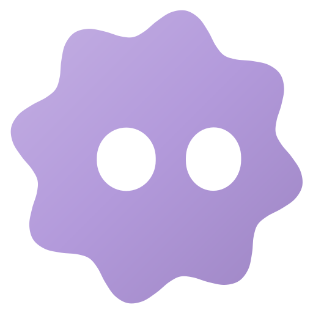

<p align="center">
  
</p>

<h1 align="center">Melt</h1>

<p align="center">A browser-based creative studio for posters, graphics and visual experiments.</p>

<p align="center">
  <a href="https://extrabinoss.github.io/MusArt/">
    
  </a>
</p>

Melt brings images, typography, shapes and effects into one editable composition. Build with layers, try different treatments, and export your artwork or a timelapse of how you made it.

Your projects save on your device. No account is required. Melt is free and open source, built as an independent project for the [2026 Meta Global AI Developer Hackathon](https://dev.meta.ai/events/global-hackathon).

[What you can make](#available-today) · [Get started](#get-started) · [Headless mode](#headless-mode) · [Documentation](docs/README.md)

The hosted editor becomes available after the first successful GitHub Pages deployment.

## Available today

| Capability                 | What you can do                                                                                                                                                                         |
| -------------------------- | --------------------------------------------------------------------------------------------------------------------------------------------------------------------------------------- |
| **Layers and composition** | Combine images, editable text, rectangles, ellipses and vectors. Nest groups, transform layers, adjust opacity and choose from 26 blend modes.                                          |
| **Editable effects**       | Stack and adjust blur, grain, halftone, dither, ASCII, CRT, cyanotype, gradients and other treatments. Fine-tune exposure, contrast, hue and color without changing the original image. |
| **Selections and masks**   | Select connected colors with the magic wand or select objects with an on-device AI model. Use images, layers or groups as masks; invert or disable them as you work.                    |
| **Typography**             | Browse bundled and Google Fonts, import TTF/OTF fonts, and use available system fonts. Style text with solid colors or gradients, spacing and alignment.                                |
| **Shapes and artwork**     | Use the built-in shape, icon and brand libraries, or import supported SVG artwork. Edit fills and strokes.                                                                              |
| **Artboards and layout**   | Keep several designs in one project. Start from social or print-size presets, use rulers and guides, snap objects into place, and adjust alignment and spacing.                         |
| **Local projects**         | Autosave in your browser, undo and redo edits, and download a `.musart` project with its original images. Reopen it later or move it to another device.                                 |
| **Image export**           | Export a selection or a whole artboard as PNG, JPEG or WebP, with scale options up to 4×. Download all artboards together as a ZIP.                                                     |
| **Creation timelapses**    | Replay your recorded edits in Animate and export an MP4 or WebM video, depending on browser support.                                                                                    |

The interface is available in **English and French**, with light and dark themes and customizable keyboard shortcuts.

## Get started

To run Melt on your computer, install **Bun 1.4.2** and **Node.js 22.12 or newer**, then run these commands from the project folder:

```sh
bun install --frozen-lockfile
bun dev
```

Open **[localhost:6100](http://localhost:6100)** in your browser.

1. Choose a template, create an artboard, or open a `.musart` file from the dashboard.
2. Drop in images, add text and shapes, then build your composition with layers, effects and masks. The **AFTERHOURS — Techno** template is an editable starting point.
3. Use **Export** to download an image, or open **Animate** to prepare a timelapse. Download a `.musart` copy from the project-name menu to keep a portable backup.

Press **Ctrl/Cmd + K** to find tools and actions. Scroll to pan, **Ctrl/Cmd + scroll** to zoom around the pointer, and click the zoom percentage to return to 100%. See the [shortcut guide](docs/guides/keyboard-shortcuts.md).

## Headless mode

Headless mode lets scripts create and edit projects, export images, or capture the editor without operating it manually.

Creating and editing project files only requires Bun:

```sh
bun run headless create --output artifacts/example.musart
bun run headless apply --input artifacts/example.musart --commands commands.json --output artifacts/changed.musart
```

`create` makes a square demo project with a MusArt text layer. `apply` reads a JSON list of editor commands and applies them together; the [headless guide](docs/guides/headless.md) includes a complete command-file example.

Rendering uses an invisible Chromium browser. Install it once:

```sh
bunx playwright install --with-deps chromium
```

Keep `bun dev` running in one terminal, then run these commands in another:

```sh
bun run headless render --input artifacts/example.musart --output artifacts/example.png --scale 2
bun run headless screenshot --input artifacts/example.musart --output artifacts/editor.png
```

See [Headless mode](docs/guides/headless.md) for image formats, artboard selection, browser automation, requirements and troubleshooting.

## Still to implement

Keyframe animation is part of the [product direction](docs/product/vision.md). The other items are current gaps and possible next steps. None has a delivery date.

- [ ] Author animation with a timeline and keyframes, beyond the existing edit-history timelapse.
- [ ] Embed custom font files in portable projects. They currently need to be installed separately in each browser.
- [ ] Support mixed left-to-right/right-to-left paragraphs and color emoji.
- [ ] Export editable vector/PDF files and print-ready, ICC-managed CMYK artwork. Current image exports are RGB.

## Before you start

- **Keep a portable backup.** Clearing your browser's site data can remove locally saved projects and fonts. A `.musart` file contains the design and original images; recorded edit history can be downloaded separately in Animate.
- **Some resources need an initial download.** Google Fonts and the object-selection model download when requested. Image processing stays on your device. See [fonts](docs/guides/fonts.md) and [local object selection](docs/guides/object-selection.md).
- **Browser capabilities matter.** Rendering needs WebGPU or WebGL2. System-font access and video encoding depend on browser support; large exports are also limited by the graphics device and available memory.

<details>
<summary>Technical details</summary>

Melt uses **TypeScript, React, Vite and Bun**, with **Three.js, React Three Fiber and TSL** for graphics. **Jotai** manages interface state; **Tailwind CSS, shadcn/Radix, Motion and i18next** support the interface. Projects are stored locally in **IndexedDB**.

The document engine can run independently of the interface. The editor and image exports share the same renderer, with WebGPU and Three.js's WebGL fallback.

Read [Technical stack and design choices](docs/architecture/tech-stack.md) for the reasons behind the stack and the [architecture contracts](docs/architecture/contracts.md) for module boundaries.

</details>

## Documentation and contributions

Start with the [documentation index](docs/README.md) for usage guides, headless automation and contributor references. Read [CONTRIBUTING.md](CONTRIBUTING.md) before making changes, follow development in the [changelog](CHANGELOG.md), and report vulnerabilities through the [security policy](SECURITY.md).

Melt's source code is available under the [MIT License](LICENSE). Fonts, models, artwork and other third-party material retain their own licenses; see [credits and provenance](docs/legal/provenance.md) and [third-party notices](THIRD_PARTY_NOTICES.md).

<p align="center">
  <a href="https://extrabinoss.github.io/MusArt/">
    
  </a>
</p>

The interface is now **Melt**. Existing `.musart` files, local browser libraries, CLI commands and package identifiers remain compatible. See [the shared brand and SVG animation API](docs/guides/brand.md).
