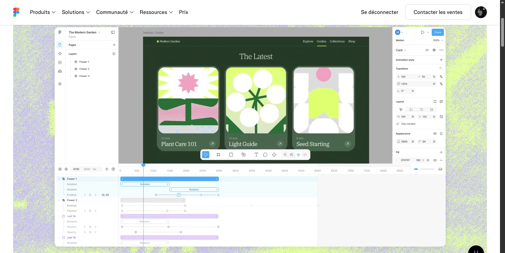
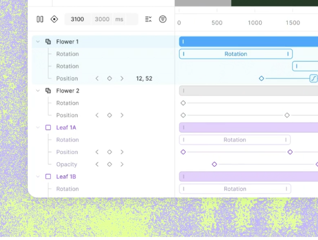

# Figma Motion reference

Research date: **2026-10-29**. Figma identifies Motion as an open beta, so this is a dated reference rather than a permanent compatibility contract. The source register below uses primary Figma documentation and official tutorials. No authenticated Figma editing session was available for direct interaction testing.

| Evidence label            | Meaning                                                                                 |
| ------------------------- | --------------------------------------------------------------------------------------- |
| **Verified**              | Explicitly described by a linked official source.                                       |
| **Observed**              | Visible in a supplied screenshot; behavior cannot be inferred from appearance alone.    |
| **MusArt requirement**    | Requested in the [verbatim brief](user-brief.fr.md), independently of Figma's behavior. |
| **Proposed / unresolved** | An adaptation or missing detail requiring a documented implementation decision.         |

## Primary sources

| ID  | Official source                                                                                                                                                  | Coverage and limits                                                                                                              |
| --- | ---------------------------------------------------------------------------------------------------------------------------------------------------------------- | -------------------------------------------------------------------------------------------------------------------------------- |
| F1  | [Explore Figma Motion](https://help.figma.com/hc/en-us/articles/41274629073303-Explore-Figma-Motion)                                                             | Entry into Motion and overall authoring workflow. Does not prove MusArt's requested per-artboard conversion rules.               |
| F2  | [Use the Figma Motion timeline](https://help.figma.com/hc/en-us/articles/41405906446999-Use-the-Figma-Motion-timeline)                                           | Timeline controls, sizing, zoom and animation-track movement.                                                                    |
| F3  | [Add, select, and delete keyframes](https://help.figma.com/hc/en-us/articles/41307938657559-Add-select-and-delete-keyframes)                                     | Inspector diamonds, recording, selection, dragging and deletion.                                                                 |
| F4  | [Adjust an animation's easing](https://help.figma.com/hc/en-us/articles/41414048690839-Adjust-an-animation-s-easing)                                             | Easing menus and editors; Hold wording needs the clarification below.                                                            |
| F5  | [Motion developer API](https://developers.figma.com/docs/plugins/api/Motion/)                                                                                    | Public temporal/value types, useful to distinguish model semantics from UI display. Beta API.                                    |
| F6  | [Motion easing reference in Figma's official MCP guide](https://github.com/figma/mcp-server-guide/blob/main/skills/figma-use-motion/references/motion-easing.md) | Incoming-segment easing and explicit Hold boundary semantics.                                                                    |
| F7  | [Quickly add motion with preset animation styles](https://help.figma.com/hc/en-us/articles/41307886266135-Quickly-add-motion-with-preset-animation-styles)       | Preset creation, placement and duration editing. Preset-library parity is not part of the user's explicit request.               |
| F8  | [Figma tutorial: Motion timeline](https://www.youtube.com/watch?v=NszP56ua9-8)                                                                                   | Official video, published 2026-07-29. Description/chapter index reviewed; footage was not independently examined frame by frame. |
| F9  | [Figma tutorial: Easing](https://www.youtube.com/watch?v=r-8MmEjl_KA)                                                                                            | Official video, published 2026-08-12. Description/chapter index reviewed with the same limitation.                               |

The videos provide follow-up demonstrations: F8 indexes timeline adjustment at 00:25, zoom at 00:51 and playback at 01:53; F9 indexes easing controls at 00:43 and Hold at 01:07. Their inclusion does not establish extra interaction facts beyond the written sources.

## Verified interaction inventory

### Workspace and timeline

| ID  | Verified behavior                                                                                                                     | Source                                                                                                        |
| --- | ------------------------------------------------------------------------------------------------------------------------------------- | ------------------------------------------------------------------------------------------------------------- |
| T1  | Toolbar Motion mode reveals a bottom timeline in the existing design file.                                                            | [F1](https://help.figma.com/hc/en-us/articles/41274629073303-Explore-Figma-Motion)                            |
| T2  | Controls include Play/Pause, Auto-keyframe, editable current time and duration, seconds/milliseconds, playback mode and collapse-all. | [F2](https://help.figma.com/hc/en-us/articles/41405906446999-Use-the-Figma-Motion-timeline)                   |
| T3  | Playback choices are Loop, Once and Ping-pong. The documented default duration is 2000 ms.                                            | [F2](https://help.figma.com/hc/en-us/articles/41405906446999-Use-the-Figma-Motion-timeline)                   |
| T4  | Top-edge drag resizes the panel; collapse minimizes it. Zoom supports a right slider, pinch and modifier-wheel.                       | [F2](https://help.figma.com/hc/en-us/articles/41405906446999-Use-the-Figma-Motion-timeline)                   |
| T5  | Dragging a layer track shifts its animations; edge handles change their duration. A timeline-end handle changes total duration.       | [F2](https://help.figma.com/hc/en-us/articles/41405906446999-Use-the-Figma-Motion-timeline)                   |
| T6  | A new preset starts at the playhead; its body moves placement, handles alter length, and inspector/timeline settings expose easing.   | [F7](https://help.figma.com/hc/en-us/articles/41307886266135-Quickly-add-motion-with-preset-animation-styles) |

T5 describes animation timing. It does **not** establish video source in/out points, slip editing, playback speed, clip-local keyframe coordinates or ripple behavior.

### Keyframes

| ID  | Verified behavior                                                                                                                      | Source                                                                                        |
| --- | -------------------------------------------------------------------------------------------------------------------------------------- | --------------------------------------------------------------------------------------------- |
| K1  | Animatable inspector fields have a diamond. First add a key, then change the property at another playhead time to create the next key. | [F3](https://help.figma.com/hc/en-us/articles/41307938657559-Add-select-and-delete-keyframes) |
| K2  | Global Auto-keyframe also records edits; red timeline/playhead indicators communicate that state.                                      | [F3](https://help.figma.com/hc/en-us/articles/41307938657559-Add-select-and-delete-keyframes) |
| K3  | Unselected keys are outlined diamonds; selected keys are filled. Click selects; double-click seeks.                                    | [F3](https://help.figma.com/hc/en-us/articles/41307938657559-Add-select-and-delete-keyframes) |
| K4  | Shift-click or marquee selects multiple keys; selecting a timeline layer selects its keys.                                             | [F3](https://help.figma.com/hc/en-us/articles/41307938657559-Add-select-and-delete-keyframes) |
| K5  | Drag selected keys to retime them. Shift-drag snaps against playhead or other keys.                                                    | [F3](https://help.figma.com/hc/en-us/articles/41307938657559-Add-select-and-delete-keyframes) |
| K6  | Seek to a key, then edit its inspector value. Delete removes selected keys; selecting a property row then Delete removes its keys.     | [F3](https://help.figma.com/hc/en-us/articles/41307938657559-Add-select-and-delete-keyframes) |
| K7  | Clicking a connecting segment opens easing.                                                                                            | [F3](https://help.figma.com/hc/en-us/articles/41307938657559-Add-select-and-delete-keyframes) |

### Easing and model details

| ID  | Verified behavior                                                                                                                                               | Source                                                                                                        |
| --- | --------------------------------------------------------------------------------------------------------------------------------------------------------------- | ------------------------------------------------------------------------------------------------------------- |
| E1  | Choices include Linear; Ease in/out/in-and-out and Back variants; Hold; Gentle, Quick, Bouncy and Slow springs. Custom Bézier and spring editors are available. | [F4](https://help.figma.com/hc/en-us/articles/41414048690839-Adjust-an-animation-s-easing)                    |
| E2  | Bézier controls accept graph handles or four-number input; custom spring exposes Bounce.                                                                        | [F4](https://help.figma.com/hc/en-us/articles/41414048690839-Adjust-an-animation-s-easing)                    |
| E3  | Easing stored on the destination key governs the incoming segment. Hold retains the previous value until the destination boundary, then switches.               | [F6](https://github.com/figma/mcp-server-guide/blob/main/skills/figma-use-motion/references/motion-easing.md) |
| E4  | API timing uses seconds. Bindings distinguish base value from keyframes; keyframe values include numeric, color and discrete types.                             | [F5](https://developers.figma.com/docs/plugins/api/Motion/)                                                   |

**Hold discrepancy:** F4's explanatory prose can suggest jumping at the segment's beginning, while F6 explicitly specifies the destination-boundary change in E3. MusArt must name and test its own step semantics. This research adopts E3 as the proposed reference and does not claim that the contradiction was verified against a live Figma session.

### Verified shortcut subset

| Input                                      | Figma action              | Source                                                                                        |
| ------------------------------------------ | ------------------------- | --------------------------------------------------------------------------------------------- |
| Space                                      | Playback toggle           | [F2](https://help.figma.com/hc/en-us/articles/41405906446999-Use-the-Figma-Motion-timeline)   |
| Cmd-wheel on macOS / Ctrl-wheel on Windows | Timeline zoom             | [F2](https://help.figma.com/hc/en-us/articles/41405906446999-Use-the-Figma-Motion-timeline)   |
| Shift-click / Shift-drag / Delete          | K4 / K5 / K6 respectively | [F3](https://help.figma.com/hc/en-us/articles/41307938657559-Add-select-and-delete-keyframes) |

No frame-step, duplicate, split, ripple, Home/End, J/K/L or universal shortcut scheme is asserted here. Add shortcuts to MusArt only after resolving its existing bindings and platform behavior.

## Supplied visual references

### Overview

### Track detail

The overview captures an editor demonstration inside a Figma website, not an instrumented application session. Approximate coordinates below refer to that supplied raster, including its website chrome. They are observations, **not official Figma tokens**. Scaling, the embedded demo and capture compression affect apparent sizes.

| Region                      | Approximate screenshot geometry           | Observation                                                                                                      |
| --------------------------- | ----------------------------------------- | ---------------------------------------------------------------------------------------------------------------- |
| Embedded editor             | x 207–1693; y 102–939                     | About 1486 × 837 captured pixels.                                                                                |
| Upper layers sidebar        | x 207–451                                 | About 244 px wide.                                                                                               |
| Upper canvas viewport       | x 451–1492; y 102–623                     | Canvas sits between the tree and inspector.                                                                      |
| Upper inspector             | x 1492–1693                               | About 201 px wide; property diamonds align beside fields.                                                        |
| Timeline                    | y 623–939                                 | About 316 px high, roughly 38% of embedded editor height; extends beneath all three upper columns.               |
| Timeline controls and ruler | y 623–666                                 | About 43 px combined captured height. Controls lead into the ruler.                                              |
| Labels/time boundary        | x ≈451                                    | Timeline label gutter aligns with the upper tree boundary.                                                       |
| Time marks                  | 500 ms major spacing in this capture      | Dense timing labels; visible range extends to about 8500 ms. This is a zoom state, not a required tick interval. |
| Layer bars / property rows  | Bars roughly 16–18 px; rows roughly 20 px | Compact density with small labels; hit targets cannot be measured from visible glyphs alone.                     |

| Visual feature           | Observed appearance                                                                        | MusArt translation                                                                                                              |
| ------------------------ | ------------------------------------------------------------------------------------------ | ------------------------------------------------------------------------------------------------------------------------------- |
| Timeline hierarchy       | Layer rows with chevrons; indented property rows, tree guide lines and child layers.       | Mirror durable document identities and ordering; do not create a second layer tree.                                             |
| Selection                | Pale cyan selected-row wash; saturated blue main duration bar.                             | Use MusArt theme selection tokens with comparable contrast and restraint.                                                       |
| Other tracks             | Neutral gray parent and lavender child bars/diamonds in this example.                      | Allow distinguishable group accents without relying on color alone.                                                             |
| Keys and segments        | Small outlined/filled diamonds; thin connecting lines; some named preset bars.             | Preserve the compact visual grammar; keep hit targets larger than visible glyphs.                                               |
| Playhead                 | Thin blue vertical line with a filled handle at ruler top.                                 | Keep the handle and current-time value synchronized without shifting row layout.                                                |
| Inline property controls | Previous/next arrows, central diamond and nearby numeric value appear in the label gutter. | Include accessible labels and clear focus/selection states. The screenshot alone does not verify these buttons' exact behavior. |
| Timeline zoom            | Compact right-side slider and another small icon.                                          | Separate temporal scale from canvas magnification. Do not guess the unidentified icon's behavior.                               |
| Viewport toolbar         | Floating compact creation toolbar above timeline.                                          | Maintain room for current MusArt tools when the timeline opens.                                                                 |

The close crop displays a current-time field beyond the displayed duration. That isolated visual does not establish whether seeking beyond duration is supported, whether the clip was transitioning, or how values clamp.

## Boundaries of the reference

| Area                          | What this research does not establish                                                            | Implementation consequence                                                                                |
| ----------------------------- | ------------------------------------------------------------------------------------------------ | --------------------------------------------------------------------------------------------------------- |
| Exact visual parity           | Source font metrics, tokens, hit boxes, easing of UI transitions and all responsive breakpoints. | Compare layouts in browser against these references; retain MusArt components and brand assets.           |
| Per-artboard lifetime         | First conversion, counted confirmation, switching back without reset.                            | Follow the user's MusArt requirements, not an inferred Figma rule.                                        |
| Video and camera              | Source trimming, decode policy, VFR handling, audio, sync and deterministic media export.        | Use the architecture/media research; do not infer these contracts from animation bars.                    |
| Track edges                   | Whether every operation rescales, clips, offsets or changes source time for each track type.     | Specify visible trim/stretch/move operations explicitly before coding gestures.                           |
| Overlapping or duplicate keys | Collision policy, ordering, interpolation before first/after last key.                           | Define validated MusArt rules and boundary tests.                                                         |
| Mixed selection               | Multi-layer inspector edits, mixed easing and grouped values.                                    | Design explicit mixed-value states and command scopes.                                                    |
| Spring solver                 | Exact preset coefficients, solver, normalization and endpoint behavior.                          | Deterministic MusArt curves need their own documented algorithm; names alone do not prove numeric parity. |
| Concurrent timelines          | Simultaneous playback of multiple artboards or nested compositions.                              | MusArt's user explicitly selected active-composition-only playback; other compositions stay frozen.       |
| Performance                   | Frame times, decode concurrency, GPU cost and React commits.                                     | Obtain real MusArt measurements; a marketing demo is not a benchmark.                                     |

## Reference review checklist

MusArt-specific follow-up decisions also require groups and descendants in the conversion count (excluding effect/property rows), and duration extension for longer imported videos without shortening existing tracks. The user deferred camera work until after video/timeline stabilization and selected an Export split-button dropdown, with a small down-chevron, for Timelapse. That action opens a simple creation-replay dialog: choose 1–30 seconds and automatically fit the full journey by adjusting replay speed; normal Motion export is not duration-limited by this dialog. The user also requests a generic headless-capable engine with UI adapters. These are product requirements from the brief, not verified Figma rules.

- [ ] Compare the implemented editor at a declared desktop viewport with both supplied captures.
- [ ] Verify the compact hierarchy, row alignment, diamonds, handle feedback and panel geometry in a real browser.
- [ ] Demonstrate the first-key/later-edit workflow, separate Auto-keyframe and easing access.
- [ ] Exercise the verified shortcut subset with canvas, timeline, fields and dialogs focused.
- [ ] Record any deliberate visual or interaction differences and their reasons in the UX specification.
- [ ] Keep these screenshots in research; do not import Figma branding or artwork into the shipped UI.

The implementation contract is [UI and UX specification](ui-ux-spec.md); this page records evidence and uncertainty rather than asserting completed functionality.
